# InHouseROS Architecture

This document describes the system architecture of InHouseROS **as it is
today**: how the libraries relate, how data flows, and what the threading
and memory models are.

> For a critical assessment and where the design should go next, see
> [`architecture_evolution.md`](architecture_evolution.md).

> All diagrams are [Mermaid](https://mermaid.js.org/) and render on GitHub and in
> most Markdown viewers.

---

## 1. System context

InHouseROS sits between robot hardware (sensors, actuators) and the consumer
world (nodes, tools, dashboards). Each communication scope uses the cheapest
transport that satisfies its latency budget.

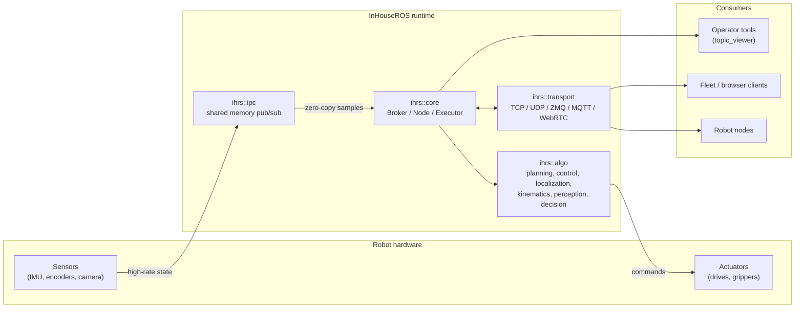

## 2. Library layering

Dependencies point strictly downward. Nothing in `ipc` or `transport` knows
about `core`; the bridge between middleware and transports happens in
applications (today) or in a future bridge node (see roadmap).

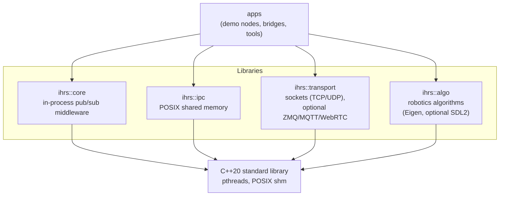

## 3. Core middleware design

### 3.1 Class model

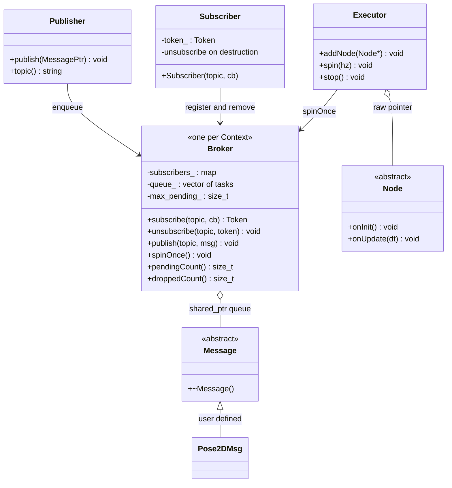

Key decisions:

| Decision | Rationale |
| :--- | :--- |
| Broker is owned by a `Context` | `Context::global()` preserves the simple default; local contexts give isolation and DI for tests |
| RAII `Subscriber` with tokens | Destroying a subscriber can never leave a dangling callback |
| Bounded queue, drop-oldest | A slow consumer can never block a high-rate publisher; drops are observable via `droppedCount()` |
| Callbacks run in `spinOnce()` | Single-threaded execution per process — no callback races, like ROS 1 spin model |
| `Node` is a plain object | Executor stores a reference; lifetime is explicit and cheap |

### 3.2 Publish/subscribe sequence

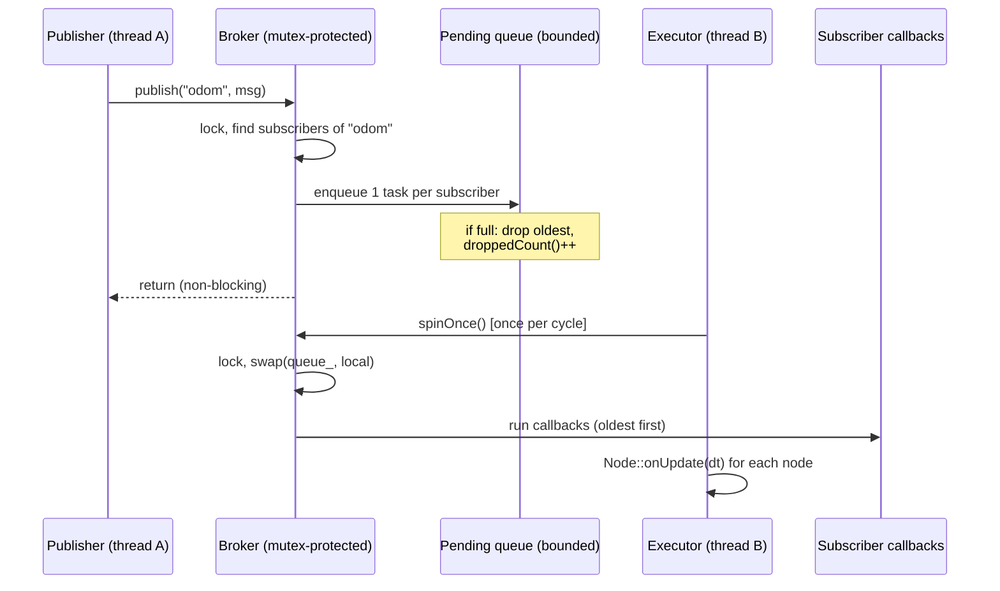

### 3.3 Executor cycle

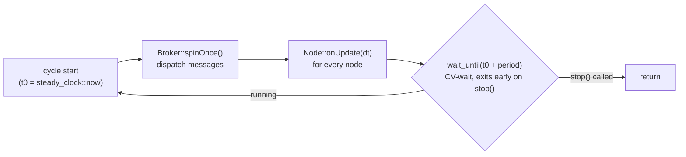

`stop()` takes the mutex, flips an atomic flag, and notifies the condition
variable, so a 1 Hz loop stops within microseconds instead of sleeping a full
cycle. `spin()` must not be stopped from its own thread (see the class docs).

### 3.4 Typed topic API and bridges (Stage 2)

The typed layer is a thin wrapper over the broker: `Pub<T>::publish(const T&)`
wraps the payload in a type-tagged `TypedMessage<T>` and enqueues through the
same broker path; `Sub<T>` unwraps and forwards `const T&` to user code.
Payload types must be trivially copyable (auto memcpy codec) or provide a
`Codec<T>` specialization — enforced at compile time. Each topic binds one
payload type hash in the broker; conflicts throw `TypeMismatchError`.

`ihrs::bridge` composes the messaging libraries into ready-made forwarding
endpoints, so no application hand-wiring is needed:

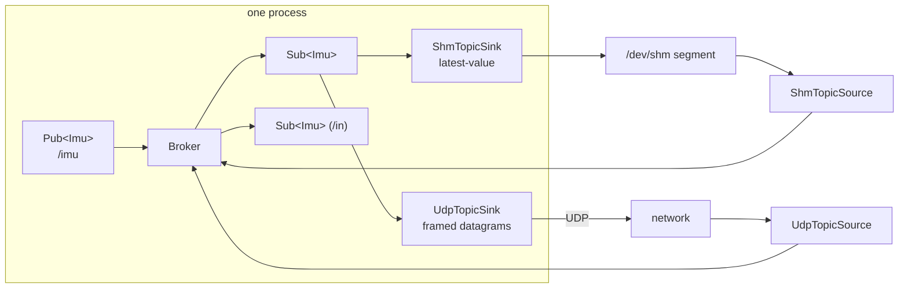

The `bridge` app maps topics to endpoints from the command line over a
per-binary type registry (`--shm-out topic:segment:Type`,
`--udp-in topic:port:Type`, ...).

## 4. IPC: shared-memory pub/sub

### 4.1 Segment layout

The first publisher for a name creates the segment (`shm_open` + `ftruncate`)
and initializes a `PTHREAD_PROCESS_SHARED` mutex; it unlinks the segment on
destruction. Subscribers attach read-write and wait for the `initialized`
flag before reading.

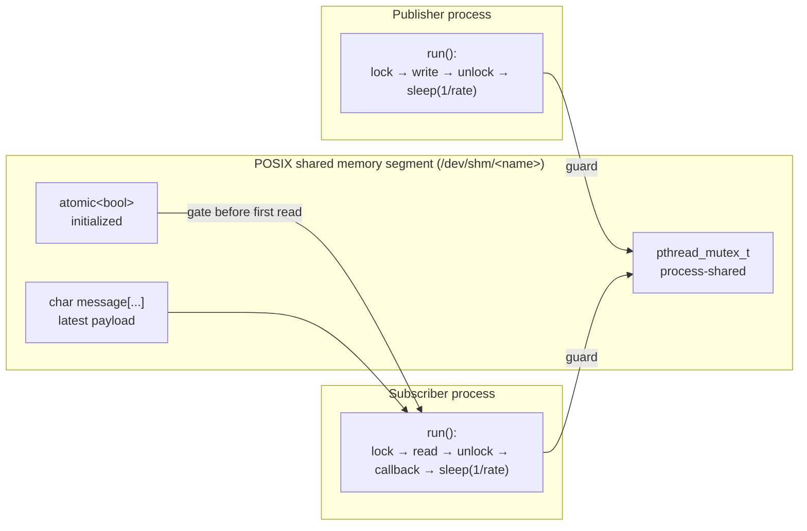

### 4.2 Typed API (`GenericSHMPublisher<T>` / `GenericSHMSubscriber<T>`)

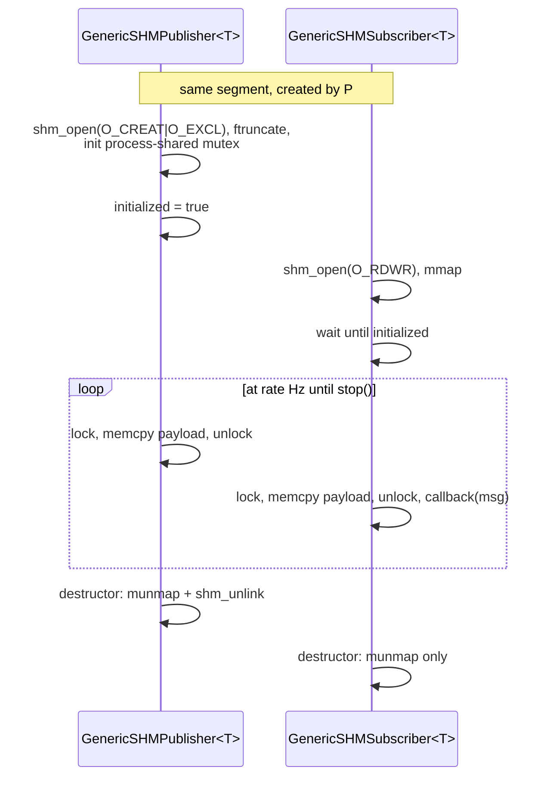

Robustness: all segments use `PTHREAD_MUTEX_ROBUST`. If an owner dies
while holding the lock, the next locker gets `EOWNERDEAD`, marks the mutex
consistent, and recovers: publishers overwrite the payload (torn data is
replaced); subscribers skip the possibly-torn sample and wait for a fresh
publish.

Remaining limitations (tracked in the roadmap): the protocol stores only
the latest message (no queueing, no liveness tracking) and `run()` polls
rather than using condition variables on the shared mutex.

## 5. Transport layer

All outbound transports implement one interface; inbound receivers expose a
blocking `run()` that returns promptly when `stop()` is called from another
thread (implemented with `shutdown()` on the socket).

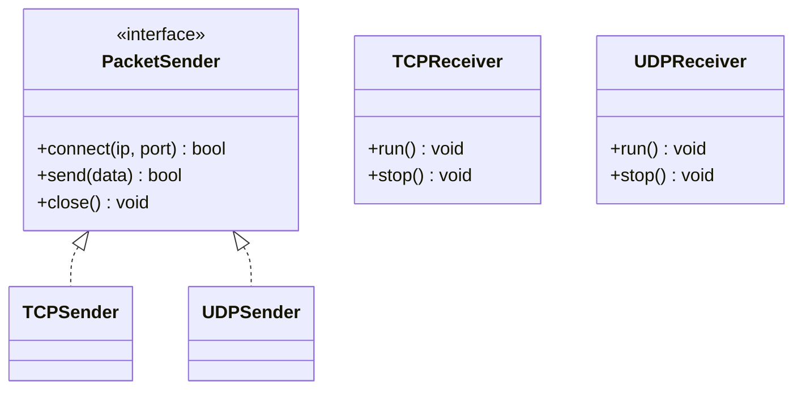

Reliability model: TCP is byte-oriented (segments may be coalesced or split —
frame the payload at the application layer), UDP is datagram-oriented (each
`send()` is one datagram, silently dropped under loss).

Optional transports (ZeroMQ, MQTT, WebRTC) are compiled only when their
dependencies are found; see the main README for the dependency matrix.

## 6. Algorithm library (`ihrs::algo`)

Domain modules follow the sense-think-act loop and depend only on Eigen
(header-only) plus the standard library; the SDL2 visualizer is optional and
private to the library.

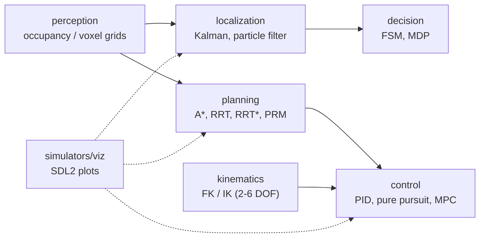

## 7. Threading model summary

| Component | Threads | Synchronization |
| :--- | :--- | :--- |
| `core::Broker` | any publisher thread, one spinning thread | one mutex; callbacks never run concurrently |
| `core::Executor` | caller of `spin()` blocks; `stop()` from anywhere | atomic flag + condition variable |
| `ipc::SharedMemory*` | one `run()` thread per process | process-shared `pthread_mutex_t` |
| `ipc::GenericSHM<T>` | one `run()` thread per instance | process-shared `pthread_mutex_t` |
| `transport::TCP/UDPReceiver` | dedicated `run()` thread | atomic flag; `shutdown()` unblocks syscalls |

## 8. Build and test infrastructure

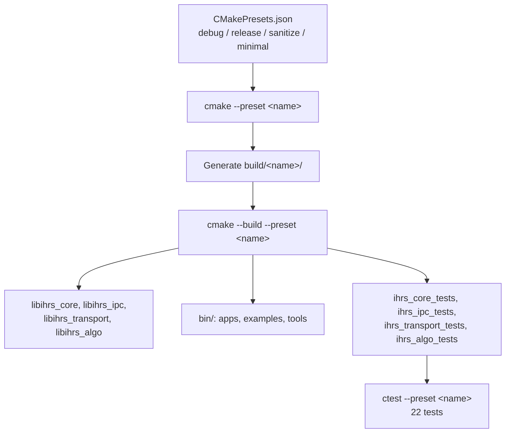

Warning policy: new middleware code builds with the strict profile
(`ihrs_warnings`: conversion + old-style-cast checks); the large imported
`ihrs::algo` codebase builds with `ihrs_warnings_legacy` (`-Wall -Wextra
-Wpedantic -Wshadow`) until it is modernized.
