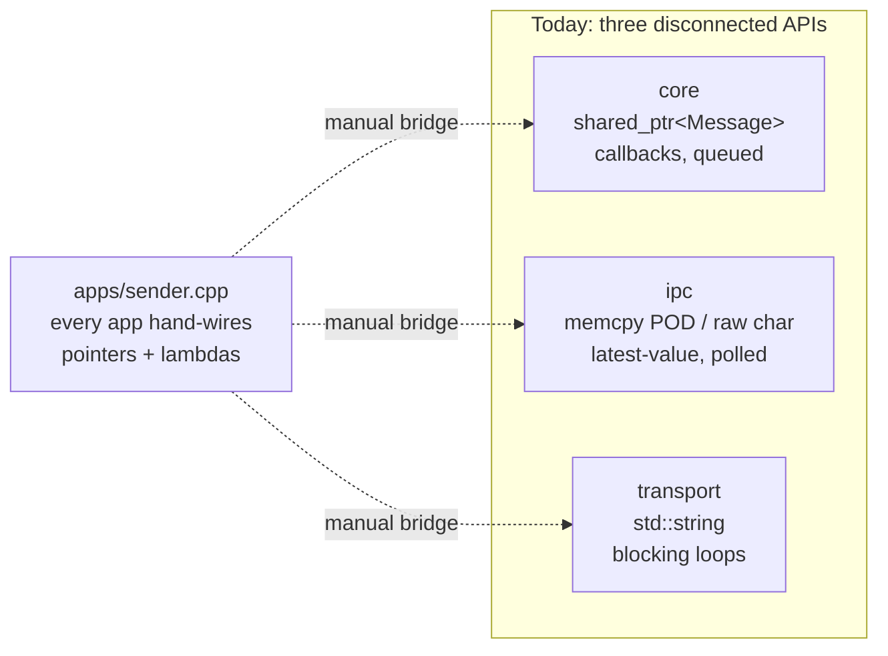
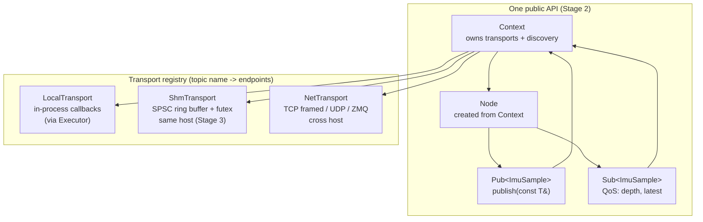
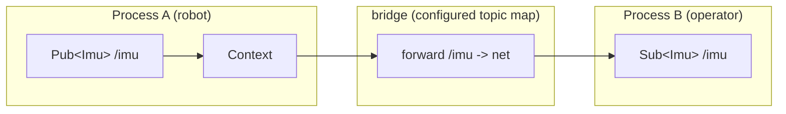

# Architecture Evolution Review

*A critical review of the current design and a proposal for where the system
should go next. Companion to [`architecture.md`](architecture.md) (what is)
and [`design_review.md`](design_review.md) (code-level findings).*

---

## 1. Verdict in one paragraph

The current design is clean **as four independent libraries** — but it is not
yet a middleware. The three messaging worlds (`core`, `ipc`, `transport`) have
three incompatible payload models, three lifetime models, and no shared topic
abstraction; every integration is hand-wired in `apps/`. The system's
promised value ("publish a topic, consume it anywhere") is not yet delivered
by the architecture — it is delivered by application glue. There is a
better design, it is a well-known one (unified topic API over pluggable
transports, à la ROS 2 / iceoryx / eCAL), and it can be reached from here in
four non-breaking stages.

## 2. What the current architecture gets right

| Strength | Why it matters |
| :--- | :--- |
| Strict downward layering, zero coupling between `ipc`/`transport`/`core` | Each library is optional, testable, and replaceable |
| RAII + token-based subscriptions, bounded broker queue | Correct by construction; back-pressure observable |
| Creator-owns-segment SHM lifecycle | Sane cleanup without a name server |
| Latest-value SHM semantics | Right default for robotics (stale data is worse than no data) |
| Feature-gated transports, dependency-light default build | `minimal` preset builds with pthreads only |

None of this should be thrown away. The proposal below **keeps all four
libraries** and changes how they are composed.

## 3. Structural limits of the current design

### 3.1 Three messaging worlds, no unification

Consequences, observable in today's code:

- `apps/sender.cpp` passes a **raw `UDPSender*`** into a SHM callback —
  manual lifetime wiring, string-only payloads, no framing.
- A node that should transparently reach another *process* (let alone
  another *machine*) requires a new bespoke bridge program.
- Type safety dies at every boundary: `core` is type-erased, `ipc` is
  memcpy-blind, `transport` is `std::string`.

### 3.2 No serialization strategy

`shared_ptr<Message>` cannot cross a process boundary; `memcpy` POD cannot
carry a `std::string` member. A middleware needs one explicit answer:
**trivially-copyable-only** (zero-copy, like iceoryx) or **serialize on
cross-boundary paths** (like ROS 2/DDS). Today the question is simply
avoided, which is why the worlds can't merge.

### 3.3 Polling + non-robust SHM sync

`GenericSHM` polls at `rate` and guards with a plain process-shared mutex:
- wake-up latency = one poll period even when idle;
- a `SIGKILL`ed publisher deadlocks every subscriber;
- no sequence numbers → staleness undetectable;
- single-slot semantics live *below* an API that looks like a queue.

### 3.4 Singleton broker & single executor shape

`Broker::instance()` gives one process-wide bus and one spinning model:
no multi-rate executors, no timers, no callback isolation, awkward DI in
tests. Fine at today's scale; a ceiling on the "OS" ambition.

### 3.5 Transport API details

`send(const std::string&)` forces a copy and forbids binary payloads with
embedded NULs (fine today only because nothing binary flows yet); `bool`
returns discard `errno`; TCP has no framing helper, so every consumer
reinvents (or forgets) message boundaries.

## 4. The better design

### 4.1 Target shape

One topic API, typed; transports become interchangeable *behind* it. This is
the same load-bearing idea as ROS 2/DDS, eCAL, and iceoryx — it is the
industry consensus because it is the shape that survives growth.

### 4.2 The serialization answer (decision, not discussion)

Adopt **both** paths behind one compile-time rule:

- `T` trivially copyable → memcpy wire format, zero-copy in SHM.
- otherwise → user supplies `Codec<T>` (`to_bytes` / `from_bytes`); wire
  format = 4-byte length + bytes (TCP), datagram (UDP), slot (SHM v2).

This keeps the learning-project ethos (no protobuf dependency) while making
cross-boundary delivery *possible* and type-checked via a
`topic_type_hash` in the topic metadata (mismatched types fail loudly at
subscription, not silently corrupt).

### 4.3 SHM v2 (Stage 3)

Replace single-slot + polling with the standard robotics pattern:

- SPSC lock-free ring buffer per (publisher, subscriber) pair — wait-free
  writes, no torn reads, natural QoS depth;
- `uint64_t seq` + monotonic timestamp in every slot header → staleness and
  loss detection;
- futex (`_GNU_SOURCE`-style) or process-shared condvar for wake-on-publish
  (polling becomes a fallback mode);
- robust mutex only where a mutex remains; publisher liveness via an
  `pid + epoch` heartbeat field so subscribers detect dead publishers.

### 4.4 Core v2 (Stage 1, enabler of everything else)

- `Context` owns a `Broker`; global instance remains as *default* context —
  current API untouched, singleton testability problem gone.
- `Executor` gains `create_timer(period, cb)` and optional callback-group
  isolation (later); remains single-threaded-by-default (that model is a
  feature, not a deficiency).
- `PacketSender::send` grows a `std::span<const std::byte>` overload +
  `send_framed()` (length-prefix) for TCP; `bool` results gain an
  `error()` accessor.

### 4.5 What a bridge becomes

With one topic API, "bridge" stops being an app you write per link and
becomes configuration:

## 5. Alternatives considered (and when they win instead)

| Option | Verdict |
| :--- | :--- |
| **Adopt ROS 2 / rclcpp** | Best if the goal shifts to shipping a product with community support. Overkill + heavyweight for the stated goals (perf, deps, learning). |
| **Adopt iceoryx2 / eCAL (shared-memory-first middleware)** | If cross-process zero-copy throughput is the primary product, these are production-proven. Worth benchmarking against Stage 3 before building it. |
| **Adopt Zenoh / nanomsg-nng for network** | Reasonable future `NetTransport` backend; the Stage-2 API accepts them without rework. |
| **Keep four separate libraries forever** | Defensible *only* if the project re-scopes as "algorithms + IPC study", not a middleware. |
| **Proposed staged evolution** | Preserves all existing value, delivers the middleware promise, bounded by learning-friendly steps. |

## 6. Staged plan (each stage ships green tests, no breaking API change)

| Stage | Delivers | Size |
| :- | :- | :- |
| **1 — Foundations** ✅ *delivered* | `Context` (default global), executor timers, byte-span transport + TCP framing (`framing.hpp`, binary-safe receivers), `last_error()` accessors, robust SHM mutexes | S |
| **2 — Unified topics** ✅ *delivered* | `Context::create_node()`, typed `Pub<T>`/`Sub<T>` with QoS, compile-time codec gate, type-hash registry with `TypeMismatchError`, `ihrs::bridge` (SHM/UDP topic bridges) + config-driven `bridge` app | M–L |
| **3 — SHM v2** | SPSC ring buffer, seq+timestamp, futex wakeup, liveness epoch; `GenericSHM` kept as compat shim | M |
| **4 — Discovery & tooling** | Topic registry endpoint, `ihrs topics` CLI, latency/loss counters exposed, optional ZMQ-backed NetTransport | M |

> **Status:** Stages 1–2 delivered. **Stage 3 is next** — working plan in
> [`stage3_plan.md`](stage3_plan.md) (Stage 2's plan remains in
> [`stage2_plan.md`](stage2_plan.md) for reference).

Sequencing logic: Stage 1 removes the singleton ceiling so Stage 2's
transport registry has a home; Stage 2's QoS + type hashes are exactly the
contract Stage 3's ring buffer implements; Stage 4 is tooling on stable
ground.

## 7. Risks & mitigations

- **Scope creep toward ROS 2.** Mitigation: the stage table above has a hard
  stop — no services, params, or tf until a real use case demands them.
- **Ring-buffer bugs are subtle.** Mitigation: acquire/release semantics
  only, seq-checking in tests, sanitizer preset runs the SHM suite.
- **Two APIs during migration.** Mitigation: Stage 2 adds rather than
  replaces; deprecation only after `bridge` covers every existing app.

## 8. Recommendation

Proceed with **Stage 1 now** (small, pure win), and treat **Stage 2 as the
project's true v1.0**: it is the first design in which "publish anywhere,
consume anywhere" is an architectural property instead of app-level glue.
Benchmark Stage 3 against iceoryx2 before implementing it.
