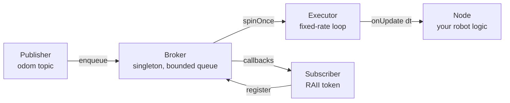

# ihrs::core

In-process publish/subscribe middleware: the "brainstem" of InHouseROS.
Topics, type-erased messages, a thread-safe broker and a fixed-rate executor.



## Components

| Class | Purpose |
| :--- | :--- |
| `Message` / `MessagePtr` | Polymorphic message base; derive your payloads |
| `Broker` | Thread-safe topic registry + bounded pending queue (drop-oldest) |
| `Publisher` | Enqueues messages on a topic; never blocks |
| `Subscriber` | RAII registration; destructor removes the callback safely |
| `Node` | `onInit()` / `onUpdate(dt)` contract for executor-driven logic |
| `Executor` | Dispatches messages and ticks nodes at a fixed rate; prompt `stop()` |

## Semantics

- **Delivery is asynchronous**: `publish()` only enqueues; callbacks run on
  the thread that calls `Broker::spinOnce()` (usually the `Executor`
  thread). One spinning thread ⇒ callbacks never race each other.
- **Back-pressure**: the pending queue is bounded (default 1024). When full,
  the oldest task is dropped and `Broker::droppedCount()` increments.
  Inspect it in your telemetry if you care about message loss.
- **Lifetime**: `Subscriber` must not outlive its callback's captures; a
  `Node` must outlive the `Executor` it was added to.
- **Threading**: `Executor::stop()` may be called from any thread *except*
  the one running `spin()` (call it from a signal-handler thread, another
  thread, or a node callback).

## Minimal example

```cpp
#include <ihrs/core/executor.hpp>
#include <ihrs/core/publisher.hpp>
#include <ihrs/core/subscriber.hpp>

struct Pose2DMsg : ihrs::core::Message { double x, y, theta; };

int main() {
    using namespace ihrs::core;

    Subscriber sub("odom", [](MessagePtr msg) {
        auto p = std::static_pointer_cast<Pose2DMsg>(msg);
        (void)p;
    });

    Publisher pub("odom");
    pub.publish(std::make_shared<Pose2DMsg>());

    Executor exec;   // spins until stop()
    exec.spin(100.0);
}
```

## Tests

`tests/core/` — broker delivery, RAII unsubscription, bounded queue,
executor rate and prompt-stop behavior. Run with `ctest --preset debug`.
