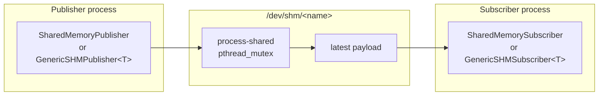

# ihrs::ipc

Cross-process pub/sub over POSIX shared memory — the ultra-low-latency path
for high-rate data (IMU, encoders) between processes on the same machine.



## Two APIs

| API | Payload | Use when |
| :--- | :--- | :--- |
| `SharedMemoryPublisher` / `SharedMemorySubscriber` | `std::string` (first 1 KB of the segment) | Quick bridging, text/status data |
| `GenericSHMPublisher<T>` / `GenericSHMSubscriber<T>` | any trivially copyable `T` | Structured high-rate data (best perf) |

## Ownership & lifecycle

- The **first publisher** for a name creates the segment and its
  `PTHREAD_PROCESS_SHARED` mutex, and `shm_unlink`s it on destruction.
- Subscribers and later publishers attach; they only `munmap`.
- The subscriber waits on an `initialized` flag before first read.
- `run()` blocks until `stop()` **or** `SIGINT`/`SIGTERM`; signal handlers
  only flip an atomic flag (async-signal-safe) — all cleanup happens in the
  destructor.
- Constructors throw `std::runtime_error` on failure instead of calling
  `exit()` (library code must not terminate the host process).

## Example (typed)

```cpp
#include <ihrs/ipc/generic_shm_publisher.hpp>
#include <ihrs/ipc/generic_shm_subscriber.hpp>

struct ImuSample { double ax, ay, az; };

int main() {
    ihrs::ipc::GenericSHMPublisher<ImuSample> pub(
        "/imu", sizeof(ImuSample) + 128, [](int i) {
            return ImuSample{i * 0.1, 0.0, 9.81};
        }, 200);

    ihrs::ipc::GenericSHMSubscriber<ImuSample> sub(
        "/imu", sizeof(ImuSample) + 128, [](const ImuSample& s) {
            // consume at 200 Hz
        }, 200);

    std::thread t([&] { sub.run(); });
    pub.run();   // blocks until stop()/SIGINT
    sub.stop();
    t.join();
}
```

## Known limitations (see roadmap)

- Latest-value semantics only: no queueing, no per-subscriber cursors.
- The shared mutex is **not robust**: a SIGKILLed publisher leaves the lock
  held until the segment is removed from `/dev/shm`.
- Polling at `rate`, not condition-variable wakeup.

## Tests

`tests/ipc/` — real publisher/subscriber roundtrip on a live segment plus
prompt-stop behavior. Run with `ctest --preset debug`.
