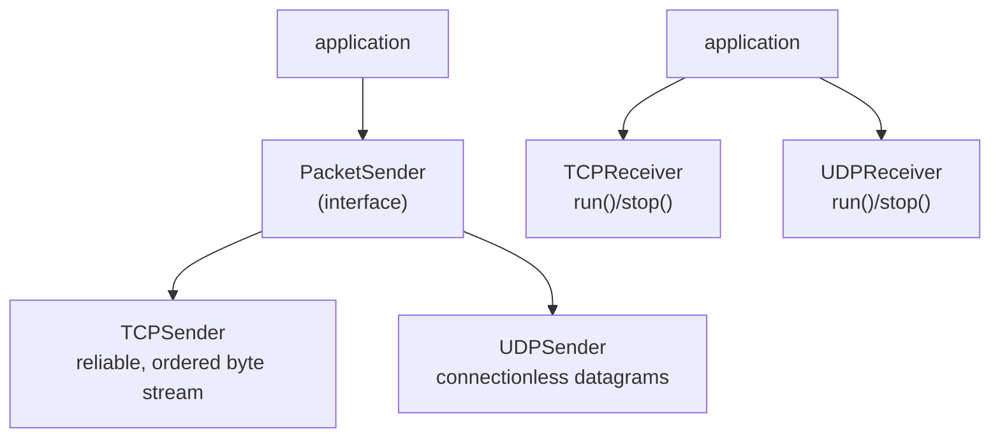

# ihrs::transport

Network transports behind one small interface: TCP and UDP are always
built; ZeroMQ, MQTT and WebRTC compile only when their dependencies are
found (feature options `IHIRS_WITH_*`).



## Interface contract

`PacketSender` (outbound):

- `connect(ip, port)` prepares the transport; call before `send()`.
- `send(data)` returns `true` only if the **full** payload was handed to
  the socket; no partial sends escape the interface.
- `close()` is idempotent; the destructor closes.

Receivers (inbound):

- `run()` blocks — put it on a dedicated thread.
- `stop()` (from any other thread) unblocks `accept()`/`recv()`/`recvfrom()`
  via `shutdown()`, so `run()` returns promptly. This is what makes the
  receivers unit-testable.
- TCP delivers a **byte stream**: one `send()` may arrive as several
  callbacks and vice versa — frame your protocol above this layer. UDP
  preserves datagram boundaries but may drop or reorder.

## Example: SHM → UDP bridge

```cpp
#include <ihrs/ipc/shm_subscriber.hpp>
#include <ihrs/transport/udp_sender.hpp>

int main() {
    ihrs::transport::UDPSender udp;
    udp.connect("192.168.1.20", 9870);

    ihrs::ipc::SharedMemorySubscriber sub(
        "/imu", 4096,
        [&](const std::string& msg) { udp.send(msg); },
        200);

    sub.run();  // blocks; Ctrl+C or stop() from another thread exits
}
```

## Transport selection guide

| Scope | Transport | Notes |
| :--- | :--- | :--- |
| Same machine, high rate | `ihrs::ipc` (shared memory) | Prefer over any socket |
| LAN control/state | UDP | Low latency, tolerate loss |
| Reliable commands | TCP | Frame the stream yourself |
| WAN / NAT traversal | WebRTC (optional) | Browser-compatible data channels |
| Fleet telemetry | MQTT (optional) | Broker-based, low frequency |

## Tests

`tests/transport/` — TCP and UDP loopback delivery plus prompt-stop
behavior. Run with `ctest --preset debug`.
